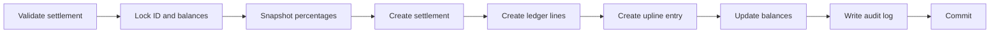
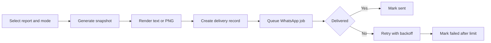
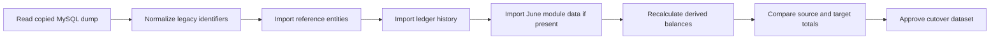

# iBook Rebuild Project Specification

## 1. Product definition

iBook is a multi-company financial ledger and settlement platform. It manages companies, agents, IDs, settlements, uplines, shareholders, users, reports, WhatsApp delivery, backups, and audit history in one system.

The rebuild will preserve the business behavior recovered from Maibook, mibook.dev, MyBook.you, and iBook.you. The new implementation will use Next.js, React, TypeScript, Prisma, and PostgreSQL.

The Laravel application, copied database, historical Devin conversations, screenshots, audit reports, and recovered Git branches are the reference set. The original June server source is unavailable, so some June features will be recreated from observed behavior rather than copied source.

## 2. Product goals

1. Recreate every recoverable feature from the June iBook.you build.
2. Preserve the financial calculations and historical data.
3. Replace the Laravel and MySQL implementation with a typed Next.js and PostgreSQL system.
4. Provide consistent desktop, tablet, mobile, print, and PDF experiences.
5. Keep sensitive operations permission-controlled and fully audited.
6. Support both the web application and a versioned API.
7. Keep production messaging isolated during migration and testing.

## 3. Evidence and decision status

| Status | Meaning |
|---|---|
| Recovered | Present in the restored repository or copied database |
| Historical | Confirmed by old implementation messages, screenshots, or audit reports |
| Recreated | Must be implemented from the confirmed behavior because the June source is unavailable |
| Modernized | New technical implementation selected for the rebuild |

Every acceptance test will identify the evidence used for the expected behavior.

## 4. Users and access model

### SuperAdmin

- Full access to every company and module.
- Uses the full left sidebar layout.
- Manages users, roles, permissions, settings, backups, audit logs, database tools, and WhatsApp connectivity.
- Can grant or deny individual modules for a user.

### Admin

- Full operational access to permitted modules and companies.
- Uses the horizontal top navigation layout.
- Can manage companies, agents, entries, IDs, reports, users, backups, settings, and WhatsApp when granted.

### Manager

- Uses the horizontal top navigation layout.
- Works only with assigned companies and granted modules.
- Can manage operational records where the company access level permits it.

### Employee

- Uses the horizontal top navigation layout.
- Sees assigned companies only.
- Read access allows viewing and reporting.
- Full access allows entry creation and modification within assigned companies.

### Permission rules

- Role permissions provide defaults.
- A user-level module grant or denial overrides the role default.
- Company access is independent from module access.
- All server routes and API endpoints enforce access. Hidden navigation alone is never treated as authorization.
- Restricted access returns a branded 403 response.

## 5. Navigation and information architecture

### SuperAdmin navigation

- Dashboard
- Companies
- Agents
- IDs
- Uplines and Groups
- Transactions
- Employees and Users
- Company Assignments
- User Company Access
- Owners and Business Partners
- WhatsApp
- Reports
- Backups and Backup Emails
- Audit Logs
- Website Settings
- Database Management

### Admin, Manager, and Employee navigation

- A compact horizontal header with role-permitted destinations.
- No left sidebar.
- Full-width content below the header.
- Responsive collapse into a touch-friendly mobile menu.

### URL behavior

- Clean company URLs such as `/companies/88` and a compatible short form such as `/c/88`.
- Selected company tab, agent, filters, sorting, search, and pagination remain in the URL where useful.
- Browser back and forward restore within-page state.
- Table state persists for 30 minutes.
- Create and edit forms return users to the previous filtered view.
- Unknown company URLs render the branded 404 page.

## 6. Visual design specification

### Brand system

| Token | Value | Use |
|---|---|---|
| Brand gold | `#ffcf0f` | Primary actions, active navigation, highlights |
| Entry header amber | `#ffeebb` | Ledger and entries table headers |
| Dark navy | `#1a1d2e` | SuperAdmin sidebar and role headers |
| Positive | `#0d6efd` | Positive balances and credits |
| Negative | `#dc3545` | Negative balances, debits, destructive actions |
| Surface | White | Cards, tables, dialogs |
| Canvas | Light neutral | Application background |

### Layout rules

- Dense financial screens use the available width without large decorative gaps.
- Cards, dialogs, tables, fields, and tabs use one spacing scale and one radius scale.
- Primary actions use gold. Secondary actions use neutral styling. Destructive actions use red.
- Entry tables use amber headers with black text.
- List tables use a restrained neutral header.
- All dialog headers use the brand gold treatment.
- Positive and negative balances use the same color semantics everywhere.
- Actions remain visible or horizontally reachable at every supported width.
- Desktop financial tables may scroll horizontally. Sticky key columns keep the record identity and actions reachable.
- Mobile controls meet touch target sizing requirements.

### Core screens

#### Login

- iBook branding and logo.
- One identity field accepting username, email, or phone.
- Password visibility control.
- Forgot-password flow.
- OTP choice and verification when enabled.
- Clear validation without exposing server details.

#### Dashboard

- Summary cards for companies, users, transactions, agents, IDs, backups, and WhatsApp status.
- Quick actions.
- Recent audit activity.
- Company balances with search and pagination.
- Company grid and list views.

#### Company workspace

- Company identity, active status, current totals, and report actions.
- Searchable agent list.
- Tabs for Entries, Company Settings, Uplines, and Shareholders.
- Selected agent context remains visible while reviewing entries.
- Inline entry form supports keyboard progression with Enter.
- Print and report views remove navigation and controls.

#### List modules

- Search, filters, sortable columns, pagination, column visibility, and CSV export.
- Stable action placement for view, edit, deactivate, delete, restore, and print.
- Loading, empty, success, and failure states use the same design language.

## 7. Functional modules

### 7.1 Authentication and account security

- Login by username, email, or phone.
- Password hashing using a modern adaptive algorithm.
- Configurable password complexity.
- Login throttling and account lock protection.
- Optional OTP through SMS or email.
- Device limits and session revocation.
- Account expiry dates.
- Change password and profile management.
- Secure, HTTP-only session cookies.

### 7.2 Dashboard

- Role-aware statistics.
- Company and ledger totals.
- Recent transactions and audit activity.
- Backup freshness alerts.
- WhatsApp disconnected alerts.
- Quick links use the current user's permissions.

### 7.3 Companies

- Create, rename, activate, deactivate, and delete.
- Company settings include name, status, notes, contact number, and email.
- Company cards show agent counts and company balance.
- Deactivation preserves all records.
- Deletion requires explicit authorization and confirmation.

### 7.4 Agents

Agents are the canonical replacement for the older Partner or User ledger entity.

- Create, edit, activate, deactivate, and soft-delete.
- One agent may be assigned to multiple companies.
- Agent name autocomplete searches existing agents before creation.
- Selecting an existing agent creates a company assignment and avoids a duplicate.
- Duplicate-agent prevention is case-insensitive and whitespace-normalized.
- Agent list shows all assigned companies.
- Agent detail shows entries across companies and an overall closing balance.
- Company agent view shows entries and closing balance for that company only.
- Entries show date, ID or company name, site, remarks, coins, rate, credit, debit, and running balance.

### 7.5 Ledger entries and transactions

- An entry records a sender, receiver, coins, rate, remarks, company, source, and timestamp.
- Cash value equals `coins × rate`.
- Positive and negative coins preserve the recovered sender and receiver direction rules.
- Every mutation runs inside a database transaction.
- Opening and closing balances are snapshots for historical display.
- Current balances are derived from active ledger entries.
- Modifying an old entry recalculates every later affected running balance.
- Soft-deleted entries are excluded from totals and can be restored.
- Permanent deletion is restricted and audited.
- Manual entries identify the company affected.
- Settlement entries identify the ID and upline or site.

### 7.6 IDs

- Create an ID and assign it to a company and agent.
- ID type supports Sub Agent and Agent.
- Store the ID name, status, percentage rate, agent, company, upline, and group.
- Prevent duplicate IDs within the applicable business scope.
- Show current ID balance and complete settlement history.
- Permit edit, status toggle, and restricted deletion.
- Make the module visible to every permitted role.

### 7.7 Settlements

- A settlement must have a nonzero amount.
- Settlement creation updates the ID balance, agent ledger, company ledger, and settlement history atomically.
- Every settlement receives a stable transaction identifier.
- Settlement records retain the percentage values used at that time.
- Retries are idempotent and cannot create duplicate ledger entries.
- Failure at any step rolls back the entire settlement.
- The operation creates an audit record.

### 7.8 Agent and Sub Agent settlement rules

The calculation uses the settlement amount and the percentage stored for the ID.

```text
agent_share = absolute(settlement_amount) × agent_percentage ÷ 100
company_share = absolute(settlement_amount) - agent_share
```

- The Agent type posts the recovered corresponding share to the agent and company ledgers.
- The Sub Agent type posts the amount the agent owes the company as the company-side entry.
- Shareholder reporting always calculates agent share from the settlement and stored percentage. It never infers agent share from the ledger entry amount.
- Percentage snapshots prevent later rate changes from rewriting historical profit.

> **Decision of 24 Nov 2026 (owner, supersedes the absolute-value rules in 7.8 and 7.11 for new settlements).**
> - Profit follows the settlement sign. A settlement of −1000 produces negative shares: agent −X%, company −(100−X)% before uplines, and the shareholders' profit is negative in proportion. The shares are stored as magnitudes. The sign comes from `settlement.amount` and is applied when profit is aggregated (`summarizeSettlementProfit` in `lib/domain/finance.ts`).
> - Sub Agent type at X%: the agent posts (100 − X)% of the settlement. Example: a Sub Agent ID at 80% posts +20 to the agent on a 100 settlement. The applied percentage is stored in the settlement's `agentPercentage` snapshot. An Agent-type ID at X% still posts X% (20% posts +20).
> - Existing settlements are not recalculated. The Sub Agent rule applies only to settlements created after this release. Old negative settlements are displayed with their sign.
> - Unit tests cover positive and negative settlements for both types (`lib/domain/finance.test.ts`).

### 7.9 Uplines and Groups

- Create and manage uplines or sites.
- Create groups and assign uplines or IDs.
- Link an ID settlement to its upline.
- Generate settlement-derived upline entries.
- Support manual upline entries for balance management.
- Shareholder profit calculations include settlement-derived upline entries only.
- Manual upline entries affect the upline balance and do not affect company profit.

### 7.10 Manual distribution

- Manual agent entries can be distributed across the agent's assigned companies.
- The allocation pays smaller outstanding company balances first.
- If the amount exceeds the available balances, the remainder is split evenly across assigned companies.
- If all balances are zero, the whole amount is split evenly.
- The distribution and all ledger entries commit atomically.
- Manual agent and upline entries never change the settlement-based shareholder profit calculation.

### 7.11 Shareholders

- Manage shareholders inside each company.
- Store name, percentage, contact details, status, and effective dates.
- Total active ownership cannot exceed 100 percent for an effective period.
- Show total settlements, agent share, upline share, company profit or loss, and each shareholder allocation.
- Support shareholder entries and running balances.
- Preserve calculation snapshots by settlement period.

```text
total_settlements = sum of absolute ID settlement amounts
agent_share = sum of absolute settlement amount × settlement agent percentage
upline_share = sum of settlement-derived upline amounts
company_profit = total_settlements - agent_share - upline_share
shareholder_profit = company_profit × shareholder_percentage ÷ 100
```

Manual agent entries and manual upline entries are excluded from this calculation.

> Per the 24 Nov 2026 decision in 7.8, `total_settlements`, `agent_share`, `upline_share` and `company_profit` are summed with the settlement sign, so a negative settlement reduces company and shareholder profit.

### 7.12 Owners and Business Partners

- Maintain reporting recipients with one or more phone numbers.
- Assign agents to each recipient.
- Preview the recipient's report before delivery.
- Keep Owners and Business Partners as separate concepts until the migrated data confirms they can be unified safely.

### 7.13 Reports

- Company summary grouped by positive, negative, and zero balances.
- Agent ledger report with chronological entries and running balance.
- ID and settlement report.
- Upline and group report.
- Shareholder profit report.
- Print, PDF, PNG image, and CSV export where applicable.
- Report filters remain in the URL.
- Generated reports contain company branding and generation metadata.

### 7.14 WhatsApp

- SuperAdmin and permitted Admin users can connect and disconnect WhatsApp Web.
- The settings page displays disconnected, QR ready, connecting, connected, and error states.
- QR refresh does not require a full page reload.
- Reports support Text, PNG Image, and Both modes.
- PDF remains a separate print or download action.
- Individual and bulk delivery are supported.
- Templates support preview and variables.
- Every outbound message stores recipient, template, payload reference, status, attempts, error, and timestamps.
- Failed messages retry with bounded exponential backoff.
- Testing environments never send unless an explicit safe test recipient is configured.

### 7.15 Email and OTP

- SendGrid-compatible email delivery.
- Twilio-compatible SMS OTP delivery.
- Provider credentials remain in environment secrets.
- Delivery failures appear in operational logs without leaking credentials.

### 7.16 Employees, users, and access administration

- Create and edit users.
- Assign SuperAdmin, Admin, Manager, and Employee roles.
- Assign company read or full access.
- Grant or deny modules per user.
- Configure OTP, device limit, expiry date, and active status.
- Revoke active sessions and reset registered devices.
- User actions are audited.

### 7.17 Website settings

- Site title, logo, contact details, and report branding.
- Twilio and email feature toggles.
- WhatsApp and backup operational settings.
- One canonical settings store replaces the three historical settings tables.

### 7.18 Backups

- PostgreSQL backups use `pg_dump`.
- Scheduled daily backup at 2 AM.
- Thirty-day retention by default.
- Backup status, size, checksum, storage location, and completion time are recorded.
- Download, upload, verify, and restore flows.
- Restore and cleanup require elevated permission and OTP confirmation.
- Alert when the latest successful backup is stale.

### 7.19 Audit logs

- Record every create, update, delete, restore, permission change, login security action, settlement, backup, and message action.
- Store actor, action, entity, entity identifier, company, old values, new values, IP, user agent, request identifier, and timestamp.
- Filter by user, action, model, company, and date range.
- Export filtered results.

### 7.20 Database management

- SuperAdmin-only operational tool.
- Browse permitted tables, inspect records, and export CSV.
- Direct record edits and deletes require an explicit table allowlist, confirmation, and audit entry.
- Credentials, auth tokens, and internal system tables are never exposed.

### 7.21 Error handling and observability

- Branded 403, 404, 419, 429, 500, and 503 pages.
- Standard API error envelope.
- Request identifier returned with every response and shown on unexpected error screens.
- Structured server logs with sensitive-field redaction.
- Consistent inline validation and toast behavior.
- Production responses never expose stack traces.

## 8. Data model for PostgreSQL

### Identity and access

- `users`
- `roles`
- `permissions`
- `user_roles`
- `user_permission_overrides`
- `sessions`
- `device_registrations`
- `otp_challenges`
- `company_access`

### Core business

- `companies`
- `agents`
- `company_agents`
- `ledger_entries`
- `ledger_entry_lines`
- `agent_ids`
- `settlements`
- `uplines`
- `upline_groups`
- `upline_group_members`
- `upline_entries`
- `shareholders`
- `shareholder_entries`

### Reporting and operations

- `report_templates`
- `generated_reports`
- `report_deliveries`
- `whatsapp_connections`
- `whatsapp_messages`
- `owners`
- `owner_phone_numbers`
- `owner_agent_assignments`
- `backups`
- `backup_recipients`
- `audit_logs`
- `application_settings`

### Data integrity rules

- PostgreSQL UUID primary keys for new records.
- Legacy numeric and string identifiers retained in dedicated import columns.
- Money and rates use `numeric` columns. Floating-point types are prohibited for financial values.
- Foreign keys and indexes enforce relationships and query performance.
- Soft deletion uses `deleted_at` where history must remain recoverable.
- Settlement calculation inputs are snapshotted.
- Unique constraints enforce normalized agent names, scoped IDs, and idempotency keys.

## 9. Technical architecture

### Web application

- Next.js App Router.
- React and TypeScript.
- Server Components for initial data rendering.
- Client Components for tables, dialogs, keyboard workflows, and live status.
- Route Handlers and service modules for the API and mutations.
- Zod validation shared by forms and API endpoints.

### Database

- PostgreSQL as the system of record.
- Prisma schema, migrations, and typed client.
- Explicit database transactions for ledger, settlement, distribution, restore, and permission operations.
- Migration scripts import the copied MySQL data into the new normalized schema.

### Background work

- A dedicated Node worker handles report generation, WhatsApp delivery, email, backups, and retries.
- Durable jobs are stored in PostgreSQL.
- Job payloads contain identifiers rather than sensitive or duplicated business data.

### WhatsApp bridge

- A separate Node service controls Chromium and WhatsApp Web sessions.
- The service is private to the application network.
- An authenticated internal API exposes connect, QR, status, logout, text delivery, and image delivery.
- Persistent session storage survives application restarts.

### File storage

- Local object storage in development.
- S3-compatible storage in deployed environments.
- Generated PDFs, PNG reports, logos, and encrypted backup files use controlled download URLs.

### API

- Versioned under `/api/v1`.
- Web sessions for the browser and scoped bearer tokens for external clients.
- Consistent response envelope and pagination.
- OpenAPI documentation generated from validated endpoint contracts.
- Rate limits by user, token, and IP.

### Local development services

- `web` for Next.js.
- `worker` for durable jobs.
- `postgres` for the application database.
- `whatsapp` for Chromium and WhatsApp Web.
- Mail and messaging providers disabled or redirected in local development.

## 10. Critical workflows

### Settlement workflow



### Report delivery workflow



### Data migration workflow



## 11. Migration rules

- The original database remains read-only during migration work.
- Importers are repeatable and safe to rerun.
- Every legacy record keeps its original identifier for traceability.
- Source and target counts are compared per table and per company.
- Agent balances, company balances, transaction totals, and deleted record counts must reconcile.
- Ambiguous duplicate agents are reported for review rather than silently merged.
- Production messaging remains disabled throughout migration verification.

## 12. Testing and acceptance

### Financial correctness

- Recalculate representative agent balances from raw ledger history.
- Verify both positive and negative coin directions.
- Modify and restore historical entries and verify all later running balances.
- Verify Agent and Sub Agent settlement calculations.
- Verify upline deductions and shareholder allocation.
- Verify manual entries do not alter settlement-based company profit.
- Verify retrying a settlement cannot duplicate entries.

### Permissions

- Test every module for SuperAdmin, Admin, Manager, and Employee.
- Test user-level grant and denial overrides.
- Test read and full company access.
- Verify hidden modules also reject direct route and API access.

### UI

- Test every navigation destination.
- Test desktop, tablet, mobile, print, and PDF layouts.
- Verify table actions remain reachable.
- Verify dialogs, keyboard navigation, filters, back button, deep links, and persisted table state.
- Verify loading, empty, validation, permission, and server error states.

### Integrations

- Verify WhatsApp QR generation and logout without pairing during routine QA.
- Verify Text, PNG Image, and Both report controls.
- Verify message rendering with a non-delivery transport.
- Verify email and OTP with sandbox providers.
- Verify backup creation, checksum, download, and isolated restore.

### Data migration

- Compare entity counts and financial totals before and after import.
- Sample records from every company.
- Reconcile copied production balances using independent queries.
- Keep a signed migration report with unresolved exceptions.

## 13. Delivery sequence

1. Approve this specification and resolve any business-rule corrections.
2. Build the Next.js, Prisma, and PostgreSQL foundation.
3. Import companies, agents, users, access rules, and historical ledger data.
4. Implement ledger workflows and balance reconciliation.
5. Implement IDs, settlements, uplines, groups, and shareholders.
6. Implement reports, WhatsApp, email, PDF, PNG, and exports.
7. Implement administration, backups, audit, API, and error handling.
8. Run role, financial, responsive, integration, and migration regression tests.
9. Prepare deployment and cutover documentation.

## 14. Definition of done

- Every feature in this specification is implemented or explicitly removed through a documented product decision.
- All migrated financial totals reconcile within exact decimal precision.
- Every role and company access level has automated authorization coverage.
- The complete application passes the page and workflow regression suite.
- No test sends a real WhatsApp message or email without an approved test recipient.
- The local and deployed environments can be recreated from repository configuration.
- Backups and restore procedures are verified.
- Remaining differences from the June application are documented with evidence and acceptance.

## 15. Decisions requiring confirmation

1. Final public brand name and logo. Historical names include Maibook, mibook.dev, MyBook.you, and iBook.you.
2. Whether Owners and Business Partners remain separate modules permanently.
3. ~~Exact Agent-type and Sub Agent-type posting direction for every settlement sign case.~~ Decided 24 Nov 2026, see 7.8.
4. Whether Database Management should remain available in the production UI.
5. The preferred deployment platform and object storage provider.

The rebuild can begin with conservative defaults while these five decisions remain configurable.
